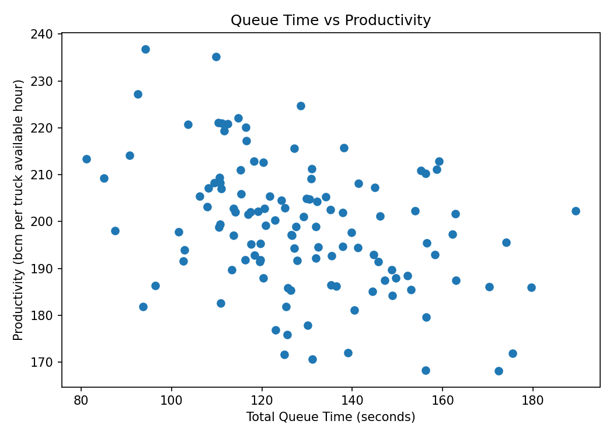
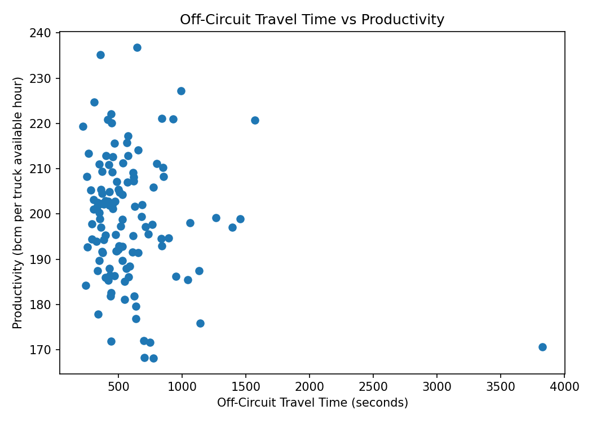

# Mining Fleet Shift Prediction

This is a small personal data science project I worked on using Python and scikit-learn. The idea was to see whether timing and randomly generated fleet-operation data could be used to predict whether a mining shift was relatively good, average, or bad.

The original dataset was larger, but I am not including the original source file here, so I added `sample_shift_data.csv`, a synthetic example with the same column structure and similar ranges. It is there mainly so the code is readable and can be run without the original data.

Some of the fields include:

| Column | What it represents |
| --- | --- |
| `Production/bcm` | Total production during the shift |
| `Truck available hours` | Total truck capacity available during the shift |
| `Queue load duration/s` | Average time spent waiting to load |
| `Queue dump duration/s` | Average time spent waiting to dump |
| `Off circuit travel time/s` | Travel time outside the normal productive cycle |
| `Total cycle time/s` | Average time for a full truck cycle |
| `Number of trucks` | Trucks operating during the shift |
| `Number of loading units` | Available loading units |
| `Saturation` | Fleet saturation measure |

I defined the main performance measure as:

```text
Productivity = Production / Truck Available Hours
```

I split productivity into thirds:

```text
bottom 33%  -> bad
middle 34%  -> average
top 33%     -> good
```

I then trained a Decision Tree to predict those labels using the other operational variables. I removed `Production/bcm` and `Truck available hours` from the model inputs because those two values are used to create the target and would cause leakage.

On the original 500-row dataset, the model reached about **63% accuracy** on a held-out 20% test set. The included synthetic dataset is only an example, so it will not reproduce exactly the same score.

I also looked at queue time and off-circuit travel because both represent time that is not directly contributing to production.





The main takeaway was that shift performance was related to more than just available capacity. Timing and operational delays contained enough information for a simple model to predict shift quality better than a random three-class baseline.

## Files

- `fleet_shift_analysis.py` — the analysis and prediction model
- `sample_shift_data.csv` — synthetic example data using the same structure as the original dataset
- the two PNG files — example exploratory plots

To run it:

```bash
python fleet_shift_analysis.py
```

The project uses pandas, scikit-learn, and Matplotlib.
